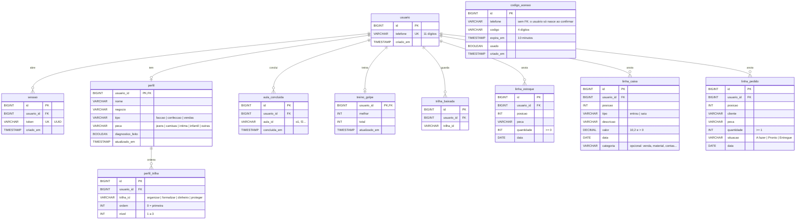

# Modelo do banco de dados

Banco relacional com 11 tabelas, criado pelas migrations do Flyway em `backend/src/main/resources/db/migration`. Em desenvolvimento roda no H2; os scripts usam SQL comum e funcionam com pequenas adaptações em MySQL ou PostgreSQL.

O GitHub e o VS Code (com extensão de Mermaid) desenham o diagrama abaixo.

## Diagrama entidade-relacionamento



## Decisões do modelo

- **Telefone como identificação.** O app não tem e-mail nem senha. `usuario.telefone` é único e o login é por código.
- **`codigo_acesso` sem chave estrangeira.** O código é pedido antes de o usuário existir. O usuário só é criado quando confirma o código certo.
- **Relações 1 para 1 com a mesma chave.** `perfil` e `treino_golpe` usam o próprio `usuario_id` como chave primária, porque cada usuário tem no máximo um de cada.
- **Trilhas normalizadas.** O front manda `trilhas` como lista e `niveis` como objeto. Em vez de guardar JSON numa coluna, cada trilha vira uma linha em `perfil_trilha`, com sua posição e seu nível.
- **Conteúdo fica no front.** Trilhas e aulas estão em `frontend/src/dados/` para funcionarem sem internet. O banco guarda só os ids (`organizar`, `o1`...).
- **Ordem das planilhas.** O front identifica cada linha pela posição na lista. A coluna `posicao` garante que as linhas voltam na mesma ordem.
- **Dinheiro em `DECIMAL(10,2)`.** Não perde centavos como um número de ponto flutuante.
- **Data em `DATE`.** Chega do front como `24/11/2026` e é convertida, o que permite consultas por período.
- **Regras no próprio banco.** `CHECK` garante os valores aceitos (tipo, peça, trilha, situação, quantidades, valor) mesmo se alguém gravar sem passar pela API.
- **Apagar em cascata.** Todas as tabelas filhas usam `ON DELETE CASCADE`. Apagar um usuário remove todos os dados dele, o que atende ao direito de exclusão da LGPD.

## Dicionário de dados

| Tabela | Para que serve | Criada em |
| --- | --- | --- |
| `usuario` | quem já entrou no app | V1 |
| `codigo_acesso` | códigos de 4 dígitos enviados por "SMS" (simulado no console) | V1 |
| `sessao` | tokens das sessões abertas (`Authorization: Bearer`) | V1 |
| `perfil` | dados do negócio e se o diagnóstico foi feito | V2 |
| `perfil_trilha` | ordem das trilhas e nível em cada uma | V2 |
| `aula_concluida` | aulas que o usuário terminou, com a data | V3 |
| `treino_golpe` | melhor resultado no treino "É golpe?" | V3 |
| `trilha_baixada` | trilhas guardadas no celular para usar sem internet | V3 |
| `linha_estoque` | planilha de estoque | V4 |
| `linha_caixa` | planilha de caixa (entradas e saídas), com categoria opcional | V4, V5 |
| `linha_pedido` | planilha de pedidos | V4 |

A tabela `flyway_schema_history`, criada pelo próprio Flyway, registra quais migrations já rodaram. Não mexa nela.

## Consultas úteis (console do H2)

```sql
-- Usuários com nome e negócio
SELECT u.id, u.telefone, p.nome, p.negocio, p.tipo, p.diagnostico_feito
FROM usuario u LEFT JOIN perfil p ON p.usuario_id = u.id;

-- Saldo do caixa de cada usuário
SELECT u.telefone,
       SUM(CASE WHEN c.tipo = 'entrou' THEN c.valor ELSE -c.valor END) AS saldo
FROM linha_caixa c JOIN usuario u ON u.id = c.usuario_id
GROUP BY u.telefone;

-- Quantas aulas cada usuário concluiu
SELECT u.telefone, COUNT(a.id) AS aulas
FROM usuario u LEFT JOIN aula_concluida a ON a.usuario_id = u.id
GROUP BY u.telefone;

-- Pedidos ainda não entregues
SELECT u.telefone, p.cliente, p.peca, p.quantidade, p.situacao
FROM linha_pedido p JOIN usuario u ON u.id = p.usuario_id
WHERE p.situacao <> 'Entregue'
ORDER BY u.telefone, p.posicao;
```
